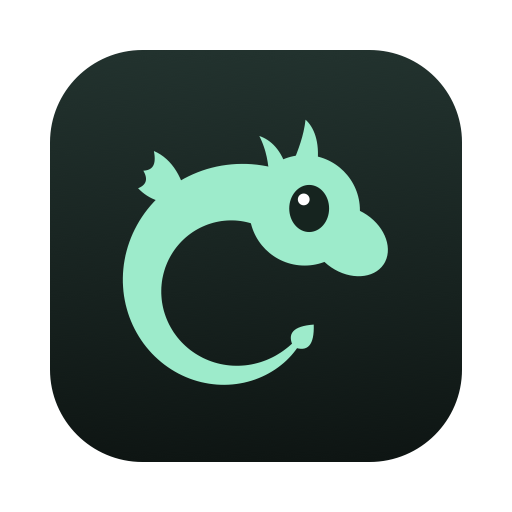
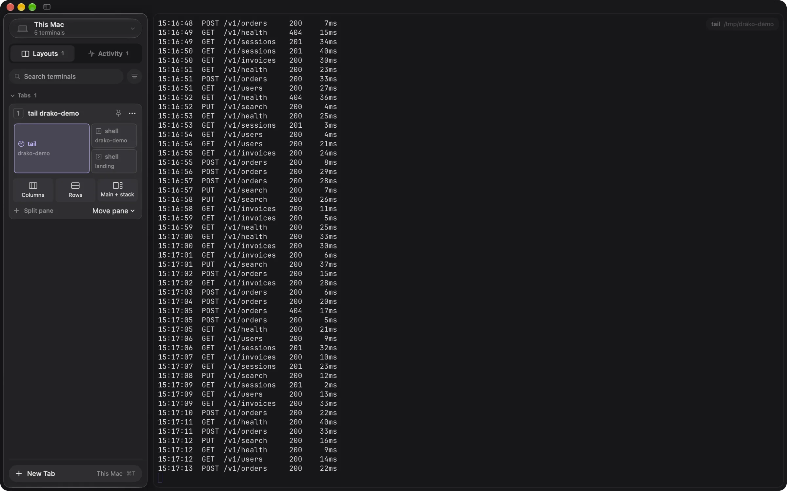

<p align="center">
  
</p>

<h1 align="center">Drako</h1>

<p align="center">
  A native macOS terminal where every pane is a persistent session.
  <br>
  Quit the app, crash, or lose the Wi‑Fi: reopen it and everything is still there.
  <br><br>
  <a href="https://github.com/ChomasDev/drako/releases/latest/download/Drako.dmg"><b>Download Drako.dmg</b></a>
  ·
  <a href="https://github.com/ChomasDev/drako-server">drako server</a>
</p>

<p align="center">
  
</p>

## What it does

- **Terminals that outlive the app.** Every pane runs in a drako session outside
  Drako. Quitting only detaches; reopening brings back every tab with its screen,
  scrollback and running programs.
- **Local and remote in the same tab.** Tabs belong to the app, panes belong to a
  host. Split a pane on this Mac next to one on a server over ssh.
- **Dropped connections are not lost work.** A pane that loses ssh shows
  `disconnected · reconnect`; press Enter and it re-attaches to the same session.
- **A sidebar that is a live layout editor.** See and rearrange tabs and panes
  across every machine, rename them in place.
- **Ghostty underneath.** Drako is a fork of [Ghostty](https://github.com/ghostty-org/ghostty):
  the same Metal renderer, the same config, keybindings and fonts.

## Install

1. Download [Drako.dmg](https://github.com/ChomasDev/drako/releases/latest/download/Drako.dmg)
   and drag Drako to Applications (macOS 26 or later). It updates itself.
2. Install the session server on this Mac:

   ```sh
   curl -fsSL --create-dirs -o ~/.local/bin/drako \
     https://github.com/ChomasDev/drako-server/releases/latest/download/drako-aarch64-macos
   chmod +x ~/.local/bin/drako
   ```

3. Add your machines from the hosts editor. Drako sets up the ssh key and
   installs drako server on each one (Linux and macOS, x86_64 and arm64).

## Build from source

You need Zig 0.17 and Xcode 27.

```sh
zig build -Doptimize=ReleaseFast -Demit-macos-app=false   # GhosttyKit
cd macos && xcodebuild -target Ghostty -configuration Release
```

The app ends up in `macos/build/Release/Drako.app`. The session server lives in
its own repo: [ChomasDev/drako-server](https://github.com/ChomasDev/drako-server).

## Releases

Pushing a tag like `v0.2.0` runs [`drako-release.yml`](.github/workflows/drako-release.yml):
it builds, signs and notarizes `Drako.dmg`, publishes it on the release and
updates the Sparkle feed (the `updates` release) with deltas from the previous
versions, so installed copies download only what changed.

The landing page in [`landing/`](landing) deploys to Cloudflare Pages on every push.

## License

MIT, like Ghostty. See [LICENSE](LICENSE).
